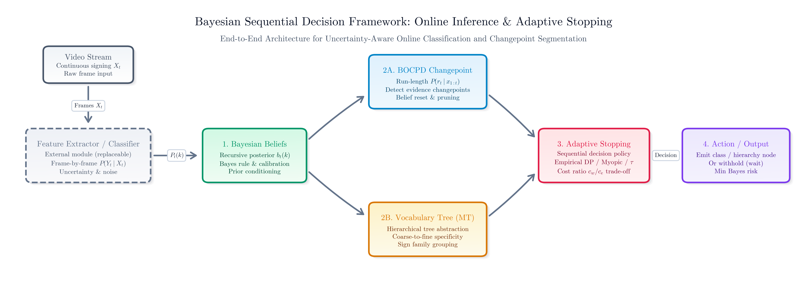
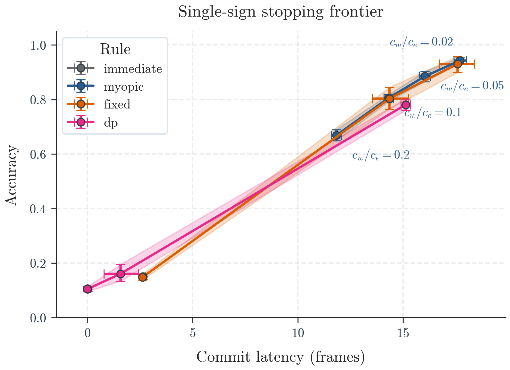
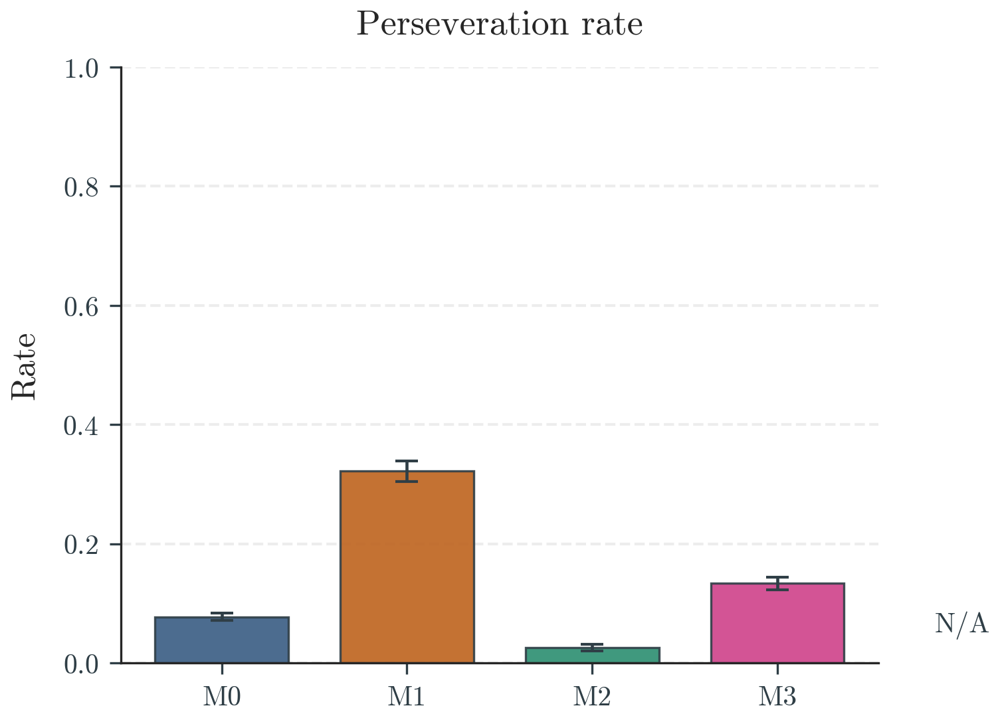
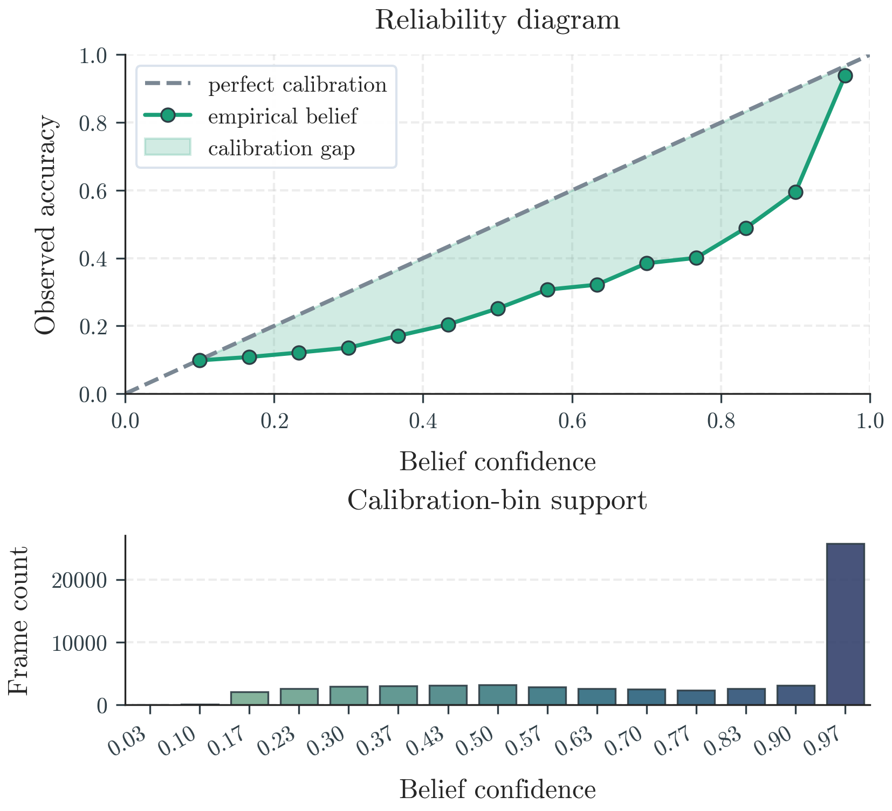
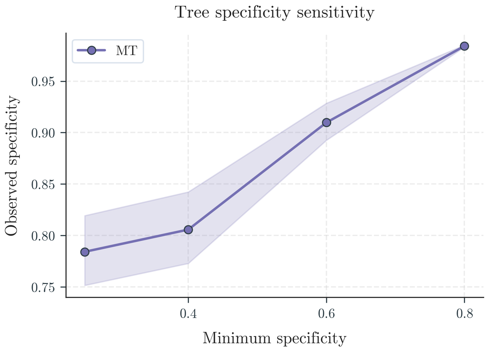
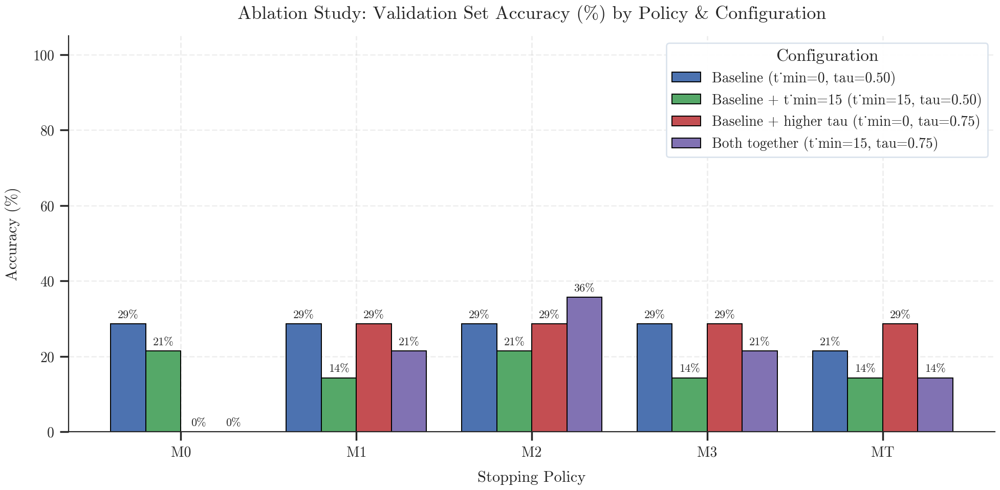
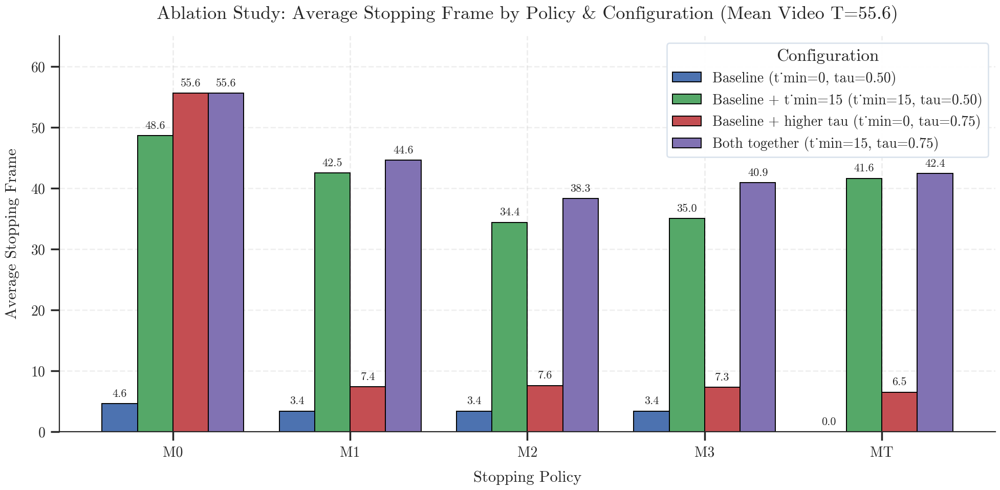
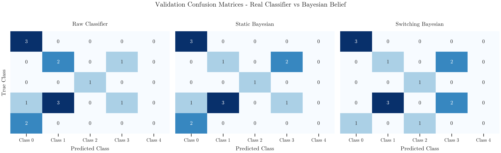
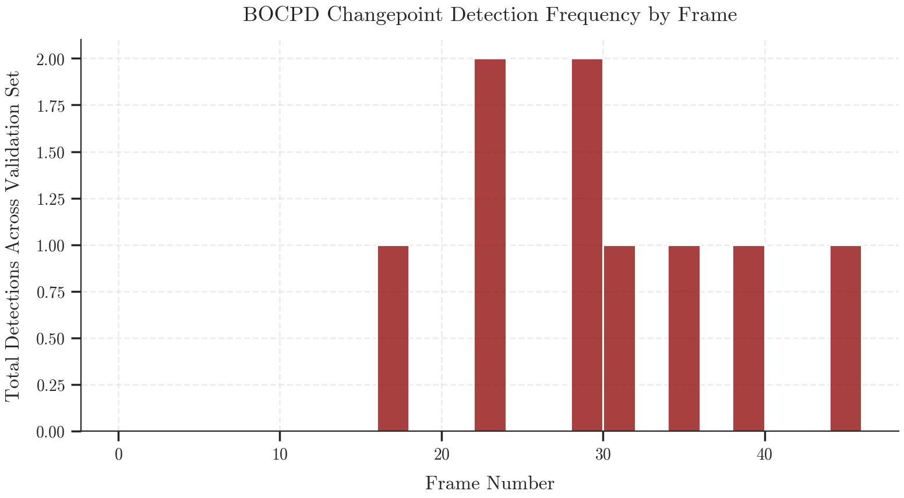

# Bayesian Sequential Decision Framework

A modular framework for online Bayesian inference, changepoint detection, and adaptive stopping policies under uncertainty.

> **TL;DR**
> - **What it does:** Wraps any frame-level classifier in a sequential Bayesian decision layer that decides *when* enough evidence has accumulated to emit a prediction—trading off latency against accuracy rather than waiting for clip termination.
> - **Validated Synthetic Results ($K=10$, 10 seeds):** Switching HMM belief filtering (`M2`) slashes post-transition stale re-emissions (perseveration) by **92%** compared to static Bayesian accumulation (`0.026` vs. `0.323`) and beats raw thresholding on boundary latency (`16.4` vs. `21.4` frames), while empirical Dynamic Programming (`DP`) cuts expected Bayes risk by up to **55%** over myopic stopping.
> - **Exploratory Real-Data Pilot (WLASL, $N=14$):** End-to-end integration succeeds on real MediaPipe + MLP probability streams, though accuracy remains low (`0.0%–35.7%`). Diagnostic auditing traced this to three concrete root causes: pre-onset commitment (policies stop at frames `0–3.4` before gestures begin around frame `28.1`), BOCPD false positives on single-sign clips without transitions, and coarse-node prior saturation at $K=5$.

### Links:
- 📖 [Devlog #1 🍎](https://medium.com/@ayushibhattacharya88/devlog-1-bayesian-sequential-decision-framework-pt-1-490c5b16657e): Explaining `evidence.py` and `belief.py`

---

## Evidence Scope

This README summarizes results from two strictly separated evaluation tracks:

1. **Synthetic evidence (headline results):** Controlled synthetic probability streams with co-articulation ramps and $\text{AR}(1)$ correlated noise across 10 predeclared seeds. Fully validated and statistically supported (paired bootstrap, 95% CIs). See `results/full_synthetic_report.json` and the full report for details.
2. **Real WLASL pilot (exploratory):** A small ($N=14$), diagnostically audited real-data evaluation on isolated sign clips. Findings below are honest and diagnostic, not a validated benchmark. Full audit trail in `results/findings.md`.

*Numbers from the real pilot are never blended into synthetic headline claims.*

---

## Motivation & Core Contributions

Many sequential recognition systems answer only one question: *what is the final class?*

Real systems often need another question answered: *when do we have enough evidence to decide?*

This repository explores Bayesian sequential decision-making rather than static classification:

- **Tempered Bayesian belief filtering:** Maintain calibrated posterior beliefs over classes frame-by-frame while discounting temporally correlated $\text{AR}(1)$ noise.
- **Multiple stopping policies:** Five decision strategies with increasing complexity:
  - `M0`: Raw confidence threshold
  - `M1`: Static Bayesian (flat log-opinion pool)
  - `M2`: Bayesian with switching prior (HMM)
  - `M3`: Bayesian + BOCPD (online changepoint detection)
  - `MT`: Hierarchical Bayesian inference (coarse-to-fine)
- **Bayesian Online Changepoint Detection (BOCPD):** Detect abrupt evidence changes and reset belief when appropriate.
- **Hierarchical inference:** Support coarse-to-fine decisions instead of only flat classification.
- **Modular, classifier-agnostic architecture:** `Classifier -> probabilities -> Bayesian engine`. Every component is independent; swap the classifier without touching the decision layer.

---

## Method at a Glance

The decision layer operates on **probability trays**—serialized per-frame class probability matrices $P \in \Delta^{K-1}$ exported by an upstream classifier across $T$ frames—using five core formulations:

1. **Tempered Recursive Bayes Update (`M1`):** Updates belief $b_t(k)$ over $K$ classes using likelihood tempering exponent $\lambda \in (0, 1]$ to prevent overconfidence from temporally auto-correlated ($\text{AR}(1)$) frame noise:
$$b_t(k) \propto b_{t-1}(k) \, p(x_t \mid k)^\lambda$$

2. **Switching Prior / Sticky HMM (`M2`):** Prevents unbounded log-odds lock-in (perseveration) across gesture transitions by mixing the previous posterior with a uniform reset prior at switching rate $\rho \in (0, 1)$ before fusing frame $t$:
$$\tilde{b}_{t \mid t-1}(k) = (1 - \rho) \, b_{t-1}(k) + \frac{\rho}{K}$$

3. **Myopic Bayes-Risk Stopping Rule:** Given per-frame wait cost $c_w$ and misclassification error cost $c_e$, stops and emits the MAP class when immediate expected error risk falls below the cost of waiting one step (inducing confidence threshold $\tau = 1 - c_w / c_e$):
$$c_e \left(1 - \max_k b_t(k)\right) \le c_w \iff \max_k b_t(k) \ge 1 - \frac{c_w}{c_e}$$

4. **BOCPD Run-Length Posterior (`M3`):** Tracks the time $r_t$ elapsed since the last regime switch under constant hazard rate $h \in (0, 1)$ and predictive compatibility $\pi_t^{(r)}$, triggering a belief reset when changepoint mass accumulates:
$$P(r_t \mid x_{1:t}) \propto \begin{cases} P(r_{t-1} = r - 1 \mid x_{1:t-1}) \, (1 - h) \, \pi_t^{(r-1)} & \text{if } r_t = r > 0 \\ \sum_{r'} P(r_{t-1} = r' \mid x_{1:t-1}) \, h \, \pi_t^{(0)} & \text{if } r_t = 0 \end{cases}$$

5. **Hierarchical Specificity (`MT`):** Evaluates internal taxonomy nodes $v$ with leaf count $|v|$ across $K$ total classes, committing to the finest node satisfying posterior mass $B_t(v) = \sum_{k \in v} b_t(k) \ge \tau$ and minimum specificity `min_sp`:
$$\text{sp}(v) = \frac{K - |v|}{K - 1}$$

---

## Experimental Pipeline



```text
Video
   ↓
MediaPipe landmarks
   ↓
MLP classifier
   ↓
Probability trays
   ↓
Bayesian inference
   ↓
Stopping policies
   ↓
Evaluation
```

> **Terminology Note:** **Probability trays** are pre-computed, per-sequence arrays of frame-level softmax probability vectors $(T \times K)$ saved from the classifier (`evidence.py` in synthetic tracks, `.pth` MLP in the WLASL pilot). Passing standardized trays into the Bayesian engine isolates decision-layer benchmarking from upstream feature extraction overhead.

---

## Results

The framework was evaluated on both synthetic probability streams and a real WLASL-derived probability dataset. The two tracks answer different questions: synthetic validates the decision layer's mechanics under controlled conditions, whereas the real pilot stress-tests those mechanics against real, noisy classifier output.

> **Policy Key (`M0`–`MT`):**
> - **`M0` (Raw Threshold):** Emits immediately when single-frame raw classifier confidence $\max_k p_t(k) \ge \tau$ (no temporal memory).
> - **`M1` (Static Bayesian):** Tempered log-opinion pool assuming a single static class across the stream.
> - **`M2` (Switching HMM):** Tempered Bayesian filter with switching rate $\rho$ to forget stale evidence across boundaries.
> - **`M3` (Bayesian + BOCPD):** Runs online changepoint detection alongside belief filtering to reset posteriors on regime shifts.
> - **`MT` (Hierarchical Tree):** Coarse-to-fine policy that commits to partial/parent clusters when leaf probabilities remain split.

### Synthetic (headline, validated)

Demonstrated:
- Bayesian filtering
- changepoint adaptation
- stopping policy comparison across latency/accuracy tradeoffs
- belief calibration
- expected-utility (Bayes risk) analysis across 4 latency cost ratios

The myopic policy is used as a simple one-step decision baseline rather than a theoretical optimum: it evaluates only the immediate Bayes risk at the current frame and does not reason about the expected value of future observations. Its stopping frontier should be read as a heuristic threshold induced by the current posterior and cost structure, not an optimal stopping boundary. This motivates comparison against the empirical finite-horizon DP approximation, which accounts for the value of future evidence. (DP slightly underperforms myopic at very low cost ratios, $c_w/c_e \le 0.02$, which is a known grid-sparsity/finite-horizon-truncation effect, not a bug.)

#### Stopping Frontier: Myopic vs. DP Reference Across Cost Ratios
*Metrics:* **Cost Ratio ($c_w / c_e$)** = ratio of single-frame waiting cost $c_w$ to misclassification error cost $c_e$; **Latency** = mean decision frame; **Risk** = realized Bayes risk $c_w \cdot \text{Latency} + c_e \cdot (1 - \text{Accuracy})$ (lower is better).

| Cost Ratio ($c_w / c_e$) | Myopic Accuracy (↑) | Myopic Latency (↓) | Myopic Risk (↓) | DP Accuracy (↑) | DP Latency (↓) | DP Risk (↓) |
|-------------------------:|--------------------:|-------------------:|----------------:|----------------:|---------------:|------------:|
| 0.02 | **0.943** | 17.7 | **0.42** | 0.890 | **16.5** | 0.44* |
| 0.05 | **0.885** | 16.0 | 0.81 | 0.860 | **10.2** | **0.65** |
| 0.10 | **0.805** | 14.3 | 1.66 | 0.760 | **6.2** | **0.86** |
| 0.20 | **0.668** | 11.8 | 3.12 | 0.550 | **4.8** | **1.41** |

*\*Note on $c_w/c_e = 0.02$:* Myopic achieves slightly lower realized risk (`0.42` vs. `0.44`) at the lowest cost ratio due to belief-grid discretization and finite-horizon truncation in the empirical DP table. From $c_w/c_e \ge 0.05$ onward, DP substantially reduces risk by stopping much earlier when additional frames yield diminishing returns.



#### Perseveration: Stale Re-emission Rate by Method
*Metrics:* **Perseveration Rate (`per_r` ↓)** = fraction of post-switch emissions naming the *previous* sign after ground truth has switched; **Sequence Error (`err_r` ↓)** = overall emission error rate across multi-sign sequences; **Boundary Latency (`hdel` ↓)** = mean delay (in frames) to detect and emit the new sign after a ground-truth transition.

| Method | Perseveration Rate (`per_r` ↓) | Sequence Error (`err_r` ↓) | Boundary Latency (`hdel` ↓) |
|--------|-------------------------------:|---------------------------:|----------------------------:|
| M1 static | 0.323 | 0.438 | 27.9 |
| M2 switch | **0.026** | 0.107 | 16.4 |
| M3 BOCPD  | 0.134 | 0.267 | 20.2 |
| MT tree   | N/A | 0.220 | **14.6** |
| M0 raw    | 0.078 | **0.066** | 21.4 |

*Tradeoff Analysis (`M2` vs. `M0` and `MT`):* While memoryless thresholding (`M0` raw) achieves the lowest overall sequence error (`0.066` vs. `0.107` for `M2`), it suffers from a **30% slower boundary latency** (`21.4` vs. `16.4` frames) and **3x higher perseveration** (`0.078` vs. `0.026`) because it waits for isolated high-confidence spikes rather than smoothly tracking transitions. `MT` achieves the fastest boundary response (`14.6` frames) by emitting coarse parent classes early, whereas `M2` delivers the best leaf-level balance of low perseveration (`0.026`), fast adaptation (`16.4`), and low error (`0.107`).



#### Reliability & Calibration



#### Hierarchical Tree Specificity Sweep



---

### Real WLASL Pilot (exploratory, $N=14$)

Demonstrated:
- end-to-end integration (real `.pth` classifier -> real trays -> Bayesian engine)
- online Bayesian inference on real classifier output
- BOCPD operation on real classifier outputs
- hierarchical stopping on real data
- policy comparison across a 4-config ablation grid ($t_{\min}$, $\tau$)

#### Real-Data Pilot Ablation Grid ($N=14$ Validation Sequences)

**Takeaway:** Across all 20 policy-configuration pairs, accuracy ranges from **0.0% to 35.7%**, and no policy is reliably superior at $N=14$. Rather than masking this noise, the pilot successfully isolated the exact operational bottlenecks—early commitment prior to gesture onset, single-clip BOCPD false alarms, and small-$K$ tree threshold saturation—documented in **Key Findings** below.

<details>
<summary><strong>📊 Click to expand the full 20-row Real-Data Pilot Ablation Table (N=14)</strong></summary>

<br>

| Configuration | Method | Accuracy (%) | Mean Stop Frame | Mean Emissions |
|---------------|--------|-------------:|----------------:|---------------:|
| Baseline (`t_min=0, tau=0.50`) | M0 | 28.6% | 4.6 | 1.29 |
| Baseline (`t_min=0, tau=0.50`) | M1 | 28.6% | 3.4 | 1.57 |
| Baseline (`t_min=0, tau=0.50`) | M2 | 28.6% | 3.4 | 2.07 |
| Baseline (`t_min=0, tau=0.50`) | M3 | 28.6% | 3.4 | 2.29 |
| Baseline (`t_min=0, tau=0.50`) | MT | 21.4% | 0.0 | 1.93 |
| Baseline + `t_min=15` (`t_min=15, tau=0.50`) | M0 | 21.4% | 48.6 | 0.29 |
| Baseline + `t_min=15` (`t_min=15, tau=0.50`) | M1 | 14.3% | 42.5 | 0.57 |
| Baseline + `t_min=15` (`t_min=15, tau=0.50`) | M2 | 21.4% | 34.4 | 1.07 |
| Baseline + `t_min=15` (`t_min=15, tau=0.50`) | M3 | 14.3% | 35.0 | 1.29 |
| Baseline + `t_min=15` (`t_min=15, tau=0.50`) | MT | 14.3% | 41.6 | 0.86 |
| Baseline + higher `tau` (`t_min=0, tau=0.75`) | M0 | 0.0% | 55.6 | 0.00 |
| Baseline + higher `tau` (`t_min=0, tau=0.75`) | M1 | 28.6% | 7.4 | 1.43 |
| Baseline + higher `tau` (`t_min=0, tau=0.75`) | M2 | 28.6% | 7.6 | 1.57 |
| Baseline + higher `tau` (`t_min=0, tau=0.75`) | M3 | 28.6% | 7.3 | 1.71 |
| Baseline + higher `tau` (`t_min=0, tau=0.75`) | MT | 28.6% | 6.5 | 1.43 |
| Both together (`t_min=15, tau=0.75`) | M0 | 0.0% | 55.6 | 0.00 |
| Both together (`t_min=15, tau=0.75`) | M1 | 21.4% | 44.6 | 0.50 |
| Both together (`t_min=15, tau=0.75`) | M2 | **35.7%** | 38.3 | 0.64 |
| Both together (`t_min=15, tau=0.75`) | M3 | 21.4% | 40.9 | 0.79 |
| Both together (`t_min=15, tau=0.75`) | MT | 14.3% | 42.4 | 0.50 |

</details>









---

## Key Findings

**Finding 1: Integration works.**
The Bayesian framework integrates end-to-end with real classifier probability streams without structural failure.

**Finding 2: Decision timing matters.**
Across all 14 real sequences, target gesture onset occurs *after* the baseline stopping frame (mean onset frame `28.1` vs. baseline mean stop frame `0–3.4`). Policies commit before the gesture has meaningfully started, which is consistent with the low real-data accuracy observed. Onset here is estimated (BOCPD posterior or class-probability threshold) rather than ground-truth labeled, so this provides a strong signal rather than a proven cause.

**Finding 3: BOCPD behaves as designed, but the setting doesn't fit isolated clips.**
Across all four ablation configs, `55.6%–70.0%` of BOCPD-triggered emissions beyond the first were false positives (wrong class) on these single-sign, single-ground-truth clips. This suggests BOCPD, designed to detect real transitions in a continuous stream, has nothing legitimate to detect on an isolated clip with one constant label, and any changepoint it fires there is close to noise by construction. It is a mismatch between the tool and this evaluation setting, not necessarily evidence BOCPD is broken for its intended use case (continuous multi-sign streams).

**Finding 4: The hierarchical policy's frame-0 commit has a root cause, not just a symptom.**
Traced to source: under a uniform prior at $K=5$, coarse node `{0,1,4}` (specificity `0.50`) starts with aggregate mass `0.60`, which is already above the $\tau=0.50$ threshold before any evidence is processed. This is a structural property of the threshold/prior combination, not a data artifact—and it is mathematically excluded in the $K=10$ synthetic headline benchmark.

<details>
<summary><strong>🔍 Click to view why this does NOT affect the synthetic headline benchmark (K=10 proof)</strong></summary>

<br>

In the synthetic headline suite (`src/experiments.py`), the problem uses **10 classes ($K = 10$)**, threshold **$\tau = 0.80$**, and minimum specificity threshold **$\text{min\_sp} = 0.25$**. Under a uniform prior $b_0(k) = 0.10$, reaching $\tau = 0.80$ requires a coarse node with at least 8 leaves ($8 \times 0.10 = 0.80$). However, an 8-leaf node has specificity:

$$\text{sp}(v) = \frac{10 - 8}{10 - 1} = \frac{2}{9} \approx 0.2222 < 0.25$$

Because $0.2222 < \text{min\_sp}$, instant frame-0 commitment under a uniform prior is mathematically excluded in the synthetic headline evaluation ($K = 10$), confirming that instant commitment is an artifact of transferring $\tau = 0.50$ and $\text{min\_sp} = 0.25$ to a small-vocabulary ($K = 5$) setting.

</details>

**Finding 5: Spec-driven verification audit caught a real fallback scoring bug.**
A post-implementation verification audit against the specification test suite (`11 defect-remediation clauses, 9 preservation requirements` in `src/test_*.py`, documented in `results/findings.md`) confirmed that the architecture matches the `M0`–`MT` specification at the constructor and parameter level. The audit also caught a scoring artifact in the exploratory real-pilot script where a non-emitting policy (`0%` emission rate) was being credited with the classifier's final-frame accuracy as a fallback, artificially inflating some ablation numbers (for example, `M0` at $\tau=0.75$ previously showed `64.3%` accuracy at `0.00` emissions). Removing the fallback and scoring non-emissions as `0.0%` corrected all four ablation configurations.

---

## What This Repository Is

This repository is not intended as a state-of-the-art sign-language recognizer. It is a reusable Bayesian sequential decision framework, demonstrated using sign-language probability streams as one applied domain. The decision-theoretic methodology (belief filtering, changepoint detection, optimal stopping, hierarchical inference) is the contribution; ASL recognition is the test bed, not the deliverable.

## Limitations

- Small real validation dataset ($N=14$)
- Simple MLP backbone for the real-pilot classifier
- Isolated single-sign clips rather than continuous multi-sign gesture streams (directly relevant to Finding 3)
- Hierarchical policy (`MT`) requires threshold/prior redesign before small-vocabulary ($K \le 5$) real-data use (Finding 4)
- BOCPD parameters (`cp_thr`, hazard rate $h$) require recalibration for real-world streams
- In small-vocabulary ($K \le 5$) applications, `MT` requires threshold ($\tau$) or minimum specificity (`min_sp`) adjustment to prevent prior-induced immediate coarse commitment (as observed in the 5-class real pilot at $\tau = 0.50$, whereas $K = 10$ synthetic benchmarks at $\tau = 0.80$ are mathematically immune).

## Future Work

- **Dynamic Policy Optimization (MDP):** The current stopping frontier relies on Empirical Dynamic Programming with frozen hyperparameters. The next iteration frames optimal stopping as a dynamic Markov Decision Process. Reinforcement Learning policies will be trained to autonomously adjust the wait cost ($c_w$), error cost ($c_e$), and switching factors ($\rho$) in real-time based on stream volatility during `real_eval`.
- **Multi-Agent Reinforcement Learning (MARL):** Expanding the framework from isolated decision-making to a competitive game-theoretic environment. Future models will deploy multiple agents on the same evidence stream to evaluate how they dynamically balance threshold confidence against competitor latency to achieve a Nash Equilibrium.
- **Continuous Gesture Streams:** Moving beyond isolated single-sign clips (where BOCPD inherently produces false positives due to a lack of genuine transitions) to continuous, multi-sign sequences where adaptive policies can effectively evaluate shifting environments.
- **Deep Model Integration:** Swapping the exploratory MLP backbone for Transformer or CNN probability generators to provide richer, more complex uncertainty profiles for the RL agents to navigate.

---

## Repository Structure

```text
Bayesian-decision-framework/
├── src/                                # Core decision-layer Python library & test suite
│   ├── evidence.py                     # Synthetic evidence stream generator
│   ├── belief.py                       # Recursive Bayesian filter & switching HMM
│   ├── stopping.py                     # Optimal stopping (Bayes tau & empirical DP reference)
│   ├── changepoint.py                  # Bayesian Online Changepoint Detection (BOCPD)
│   ├── tree_belief.py                  # Hierarchical coarse-to-fine belief tree
│   ├── policies.py                     # M0, M1, M2, M3, MT policy implementations
│   ├── metrics.py                      # Latency, perseveration, accuracy & specificity metrics
│   ├── experiments.py                  # Benchmark runner & plotting tools
│   ├── protocol.py                     # Study protocol & boundary invariants
│   ├── reporting.py                    # Report generation & JSON schema validation
│   ├── style.py                        # Plotting & CLI styling utilities
│   ├── evaluate_validation.py          # Real-data pilot evaluation pipeline (exploratory)
│   ├── run_ablation_study.py           # Real-data pilot ablation experiment runner (exploratory)
│   └── test_*.py                       # Full remediation, property, & preservation test suite
│
├── results/                            # Experimental reports & diagnostic audits
│   ├── full_synthetic_report.json      # 10-seed synthetic benchmark results
│   ├── evaluation_summary.json         # WLASL real pilot summary
│   ├── evaluation_results.csv          # Per-sequence real pilot results
│   ├── ablation_study_summary.json     # 4-config ablation summary
│   ├── ablation_study_results.csv      # 4-config per-sequence ablation results
│   └── findings.md                     # WLASL diagnostic audit report
│
├── figures/                            # Generated plots for README & reports
│   ├── pipeline_flowchart.png          # Experimental pipeline diagram
│   ├── frontier.png                    # Myopic vs. DP stopping frontier
│   ├── perseveration.png               # Stale re-emission comparison
│   ├── reliability.png                 # Probability calibration curve
│   ├── tree_specificity.png            # Hierarchical tree specificity
│   └── val_*.png                       # WLASL real-data evaluation & ablation plots
│
├── LICENSE                             # MIT License
├── CITATION.cff                        # Citation metadata
├── README.md                           # Main documentation, methods table, & audit notes
├── requirements.txt                    # Pinned Python dependencies
├── pytest.ini                          # Pytest configuration & custom markers
└── .gitignore                          # Configured to ignore local study guides, caches, & archives
```

### Note on Exploratory Evaluation Modules
`evaluate_validation.py` and `run_ablation_study.py` are standalone exploratory pilot evaluation scripts that load the classifier and execute inference on the validation probability trays. They are explicitly excluded from pytest's default test collection (`test_*.py` pattern in `pytest.ini`) and are never imported by any supported synthetic benchmark module (`experiments.py` or `test_*.py`).

---

## Setup

Requires Python 3.11 and the pinned dependencies in `requirements.txt`:

```bash
pip install -r requirements.txt
```

Key dependencies include `numpy<2`, `scipy`, `matplotlib`, and `pytest`.

## Running the Tests

Run the complete noninteractive test suite using pytest:

```bash
pytest -q
```

All 165 tests pass under CPython 3.11.9 (`11 defect-remediation clauses, 9 preservation requirements`).

## Reproducing the Synthetic Headline Report

Regenerate `results/full_synthetic_report.json` and the four synthetic headline figures across the 10 predeclared seeds:

```bash
python src/experiments.py --out results/full_synthetic_report.json
```

---

## License / Citation

Released under the [MIT License](LICENSE). This research codebase is provided as an open-source reference implementation of the Bayesian Sequential Decision Framework:

```bibtex
@software{bhattacharya2026bayesian,
  author       = {Bhattacharya, Ayushi},
  title        = {Bayesian Sequential Decision Framework},
  year         = {2026},
  url          = {https://github.com/aiyu221b3/Bayesian-Decision-Framework},
  license      = {MIT}
}
```
